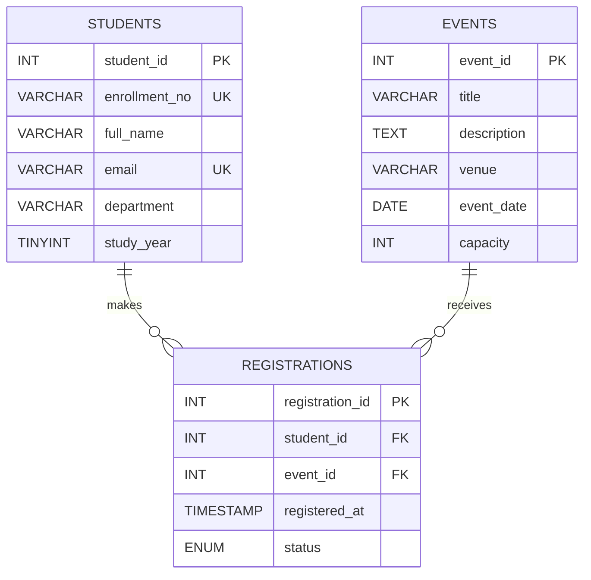

# Student Hub PR8 — ER Model

## Cardinality
- One student can have zero or many registrations.
- One event can have zero or many registrations.
- Each registration refers to exactly one student and one event.
- `registrations` resolves the many-to-many relationship between `students` and `events`.

## Normalization notes
- Student details are stored once in `students`; event details are stored once in `events`.
- `registrations` stores only the relationship and registration-specific attributes.
- Primary keys identify rows, foreign keys preserve referential integrity, and `UNIQUE(student_id, event_id)` prevents duplicate event registrations for the same student.
